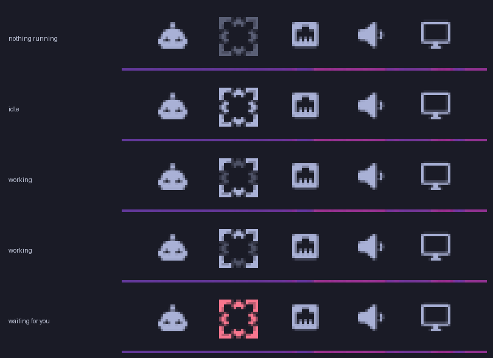
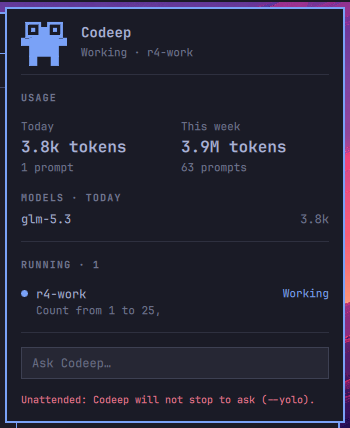

# Codeep for Omarchy

Codeep in the bar of [Omarchy](https://omarchy.org)'s shell: whether it is idle,
working or waiting for you, what it used today and this week, and a field that
starts it in a terminal with your prompt.





## What it shows

**In the bar**, Codeep's mark in the bar's own foreground colour:

| State | The mark |
|---|---|
| No Codeep running | dim |
| One is running and idle | normal |
| One is working | the four chevrons light up one after the other, about two steps a second; with the animation off, one chevron stays lit and the other three are dimmed |
| One waits for an approval or has a question | the bar's urgent colour |

Left click opens the panel, right click starts Codeep in a terminal, middle
click refreshes. The tooltip says what is going on.

**In the panel**:

- the mascot and a line saying what Codeep is doing;
- **Usage**: tokens and prompts today and over the last seven days, and tokens
  per model (today's, or all time while nothing was used today), from
  `codeep usage --json`. Refreshed when the panel opens and every 60 seconds
  while it is open;
- **Running**: every Codeep process that says it is running — project, state,
  and the short label of what it is working on. Read-only;
- **Ask Codeep…**: type a prompt and press Enter. A terminal opens running
  `codeep --prompt-file <path>`, in `~/Work` (a setting). Your prompt is not on
  that command line: it is in a private file, and only the file's path is (see
  [Where your prompt goes](#where-your-prompt-goes)). It needs Codeep 3.12.1 or
  later, and says so when yours is older. The header and this field stay put;
  usage, models and running sessions scroll (wheel, Up/Down, PageUp/PageDown)
  when there is more than fits.

Colours come from the shell's own theme tokens, so it reads on a light theme as
on a dark one. The mark is Codeep's logo (`Codeep.svg`) and the header's mascot
is the website's, drawn in the theme's accent colour; `assets/` has both as
SVG, in one colour that follows the text (`currentColor`) and the mascot in its
own red.

## Requirements

- Omarchy with the shell plugin host (Omarchy 4). Written and tested against
  the 4.0.4 package (Quickshell 0.3.1, Qt 6.11) and read against upstream's
  `quattro` branch of 2026-10-09.
- **Codeep 3.11.0 or later** for the usage and the live status: earlier ones
  have neither `codeep usage --json` nor the status files. **3.12.1 or later**
  for the Ask field, which hands the prompt over with `codeep --prompt-file`;
  before that Codeep ignores the flag and would start without it, so the
  widget checks the version and starts nothing on an older one. Install the
  build this plugin was reviewed with, checked against its digest, as "Which
  Codeep" below shows. A newer Codeep works too; moving to one is a choice you
  make, not something `mup` does behind your back.
- **Codeep set up as "Required setup before the first Ask" says, before you
  use the Ask field:** Desktop notifications Off, the audit record Off, and
  Codeep's settings folder closed to other users. These are required, not
  advised: they are the places where a prompt, or a key, can reach other users
  of the machine in Codeep 3.12.1.
- Codeep's **Share live status with Omarchy plugins** setting (on by default,
  in `/settings`, shown on Omarchy only). With it off the bar mark stays dim
  and the panel lists nothing running; usage and Ask still work.
- `find`, `timeout`, `head`, `env`, `test`, `mktemp` and `rm` (findutils,
  coreutils) and `omarchy-launch-tui`, which Omarchy has; `mise`, for a
  mise-installed Codeep. `$XDG_RUNTIME_DIR` set in the shell's environment
  (a login session does that), for the Ask field. To install Codeep as below:
  `curl`, `sha256sum`, `tar`, `gzip` and `install`.

## Which Codeep

This plugin never downloads, installs or updates Codeep, and never asks
anything to: which `codeep` runs is yours to decide, and the plugin only asks
it `--version` (and, from 3.11.0, `usage --json`). It was reviewed and tested
with Codeep **3.12.1**, and these are the Linux builds of `v3.12.1` it was
reviewed with, hashed from the downloaded files and equal to what GitHub
reports:

| Asset | Size | SHA-256 |
|---|---|---|
| `codeep-linux-x86_64.tar.gz` | 43,800,474 | `3a0e82181f3a59857fe9103d438c09744cd86879ff09f746a3867e4fb7c7e992` |
| `codeep-linux-aarch64.tar.gz` | 42,279,662 | `8cd989ef975c8abe4a797c122d3a68c5ce0447d7021ba0cb604045811498a19c` |

Install that build with the line for your machine (`uname -m`). In a temporary
folder of its own it downloads the archive, checks it against the digest above
and only if it matches unpacks it and installs that same file as
`~/.local/bin/codeep`, replacing whatever was there (the launcher
`omarchy-mise-install` writes, for one). If the check fails, nothing is
installed. When the line finishes, pass or fail, the folder is removed and your
shell is where it was (stopped halfway with Ctrl+C, the folder stays in `/tmp`
until the next reboot).

x86_64:

```bash
(d=$(mktemp -d) && cd "$d" && curl -fLO https://github.com/VladoIvankovic/Codeep/releases/download/v3.12.1/codeep-linux-x86_64.tar.gz && echo "3a0e82181f3a59857fe9103d438c09744cd86879ff09f746a3867e4fb7c7e992  codeep-linux-x86_64.tar.gz" | sha256sum -c - && tar -xzf codeep-linux-x86_64.tar.gz && install -Dm755 codeep-linux-x86_64 ~/.local/bin/codeep; rc=$?; [ -n "$d" ] && rm -rf -- "$d"; exit $rc)
```

aarch64:

```bash
(d=$(mktemp -d) && cd "$d" && curl -fLO https://github.com/VladoIvankovic/Codeep/releases/download/v3.12.1/codeep-linux-aarch64.tar.gz && echo "8cd989ef975c8abe4a797c122d3a68c5ce0447d7021ba0cb604045811498a19c  codeep-linux-aarch64.tar.gz" | sha256sum -c - && tar -xzf codeep-linux-aarch64.tar.gz && install -Dm755 codeep-linux-aarch64 ~/.local/bin/codeep; rc=$?; [ -n "$d" ] && rm -rf -- "$d"; exit $rc)
```

The plugin looks for `codeep` in the folders on its PATH first, then in
`~/.local/share/mise/shims`, `~/.local/bin`, `/usr/local/bin` and `/usr/bin`,
skipping launchers; when it finds only launchers it asks `mise which codeep`
(offline) for a binary mise has already installed. So a Codeep that comes
earlier wins, for the plugin as for a terminal. To make the plugin use exactly
the file you checked:

```bash
omarchy bar set codeep.agent codeepPath ~/.local/bin/codeep
```

In a terminal, `command -v codeep` should then print `~/.local/bin/codeep`
(expanded). If it prints a mise path, an earlier install with mise is still
active. Remove it from mise (neither command downloads anything; Omarchy's own
migrations use the same two):

```bash
mise unuse -g github:VladoIvankovic/Codeep && mise uninstall --all github:VladoIvankovic/Codeep
```

The command checks the very file it installs because a release on GitHub can be
replaced by whoever controls the repository: these releases are not immutable,
GitHub's setting that locks a release's tag and files after it is published
(that is a choice for Codeep's own repository). A failed check means the file is
not the one reviewed: the release was changed, or the download was altered on
the way. Do not install it, and say so in an issue on this repository.

A Codeep that mise has already installed is found and used too, but mise
checked its download against the digest GitHub reported on the day, not against
the digests above, so it is not covered by this review. The plugin never starts
a launcher itself, so it never installs one.

To move to a newer Codeep, read its release notes and install it the same way,
with its version and the digest GitHub shows for its asset; that check is then
yours, not this review's.

## Install

```bash
omarchy plugin add <git url>
omarchy plugin enable codeep.agent --section right --after omarchy.agents
```

(`omarchy plugin add <git url> --enable` does both at once and puts the mark in
its default place, on the right.) A plugin is code that runs inside the shell
with your rights, so Omarchy asks first and lets you read it before you enable
it. This one is about 2,200 lines of QML and JavaScript (`wc -l *.qml
Model.js`); the sections below say what it touches.

Move it with `omarchy bar move codeep.agent --section left --index 1`, remove it
with `omarchy plugin remove codeep.agent`.

From a terminal or a key binding:

```bash
omarchy-shell codeep.agent toggle      # open, close, show, hide, toggle, refresh
```

## Required setup before the first Ask

Do this once, in Codeep, before you use the Ask field. The plugin cannot do it
for you: it never writes Codeep's settings. It does not read them either (that
file can hold your API keys), so it cannot tell whether you did. The bar mark
and the usage need none of it; an Ask without it is not covered by what "Where
your prompt goes" says.

Codeep 3.12.1, the release this plugin was reviewed with, puts a few words of a
prompt in two places that other users of the machine may be able to read, and
creates its settings file readable by them (with the usual umask 022). All
three are Codeep's own, and the
first two are on by default on Omarchy. None of this is the plugin's doing, and
each step below closes one of them.

1. **Desktop notifications Off.** Start `codeep` in any terminal, run
   `/settings`, choose **Desktop notifications** and set it to **Off**. (The
   notification runs `notify-send` with the first five plain words of the
   prompt as arguments, which other users can read for as long as it runs.)
   Codeep writes an explicit Off; with nothing set, Omarchy counts as On.
2. **Audit record Off.** Run `/audit off`. (Codeep writes the first 400
   characters of every agent prompt to `.codeep/audit/` in the project, in a
   file other users can read when they can enter the project's folder.) Files
   it has already written stay: delete `.codeep/audit/` in the projects where
   you used Codeep before.
3. **Settings folder closed.** Run `chmod 700 ~/.config/codeep-nodejs`
   (`$XDG_CONFIG_HOME/codeep-nodejs` if you set that). Codeep creates its
   settings file readable by other users, and when no system keyring is
   available it keeps your API keys in that file. The folder's mode is what
   holds, whatever the file's mode is. If `codeep` warns that the system
   keychain is unavailable, install a keyring (`gnome-keyring` or another
   Secret Service) as well.

Check: `/settings` shows **Desktop notifications** Off, and `/audit off`
answers "Audit recording off". Codeep's settings are one file for all projects,
`config.json` in that folder, so this is done once per user, not per project.

What this does not cover, in Codeep 3.12.1 (fixes are planned for Codeep 4.0,
which this plugin will pin once it is released; until then they are there):

- A request that is retried after a failure looks up the provider again. If you
  switch provider with `/provider` while a request is retrying, the key of the
  first provider can go to the second. Do not switch while a reply is pending.
- A `.codeep/intelligence.json` that is a symbolic link is followed outside the
  project. Do not open a folder you do not trust with Codeep.
- A file you attach to a chat message is searched for `@web <url>` lines, and
  such a line makes Codeep fetch that address, local ones included. Do not
  attach files you do not trust.

## Settings

They live in the widget's entry in `~/.config/omarchy/shell.json`. Set one with
`omarchy bar set codeep.agent <key> <value>` (add `--json` for a number or a
boolean). A value of the wrong kind falls back to the default.

| Key | Default | What it does |
|---|---|---|
| `unattended` | `false` | **Run unattended (`--yolo`).** A prompt typed in the Ask field starts `codeep --yolo --prompt-file <path>`: Codeep runs without stopping to ask. Off by default; the panel says so in the urgent colour while it is on. A bare launch (right click) is always an ordinary session. If the work folder does not exist, an unattended run is **not started** (the panel says why and keeps your text); it never falls back to your home folder with `--yolo`. |
| `workDir` | `~/Work` | The folder Codeep starts in. Not found, an ordinary run starts in your home folder and an unattended one is refused. |
| `hideWhenIdle` | `false` | Take the mark off the bar while no Codeep runs. `omarchy-shell codeep.agent toggle` still opens the panel. |
| `refreshIntervalSec` | `60` | How often usage is read while the panel is open (15 to 3600). |
| `statusIntervalSec` | `3` | How often to look for running Codeep (1 to 60). |
| `animate` | `true` | Step the mark while Codeep works. Off holds one chevron lit instead. |
| `codeepPath` | | The Codeep binary, when it is not on the shell's PATH or in `~/.local/share/mise/shims`, `~/.local/bin`, `/usr/local/bin`, `/usr/bin`. Not a mise shim or launcher script: those are never run at all (see below). |

```bash
omarchy bar set codeep.agent unattended true --json
omarchy bar set codeep.agent workDir ~/Code
```

## What it reads, and what it never does

It reads:

- `$XDG_STATE_HOME/codeep/sessions/*.json` (default `~/.local/state/codeep/`),
  the small files Codeep 3.11 keeps while it runs: pid, project, state, a short
  task label, provider and model. The task label is the first five plain words
  of what you asked (at most 48 characters, paths and file names left out),
  which is how Codeep itself names a run in a notification: a few words of a
  prompt can be there, and no answer, command line or file content.
- `/proc`, to see which pids are alive (and `/proc/self/status` for its own uid).
- What `codeep --version` and `codeep usage --json` print. Usage comes through
  that command and nothing else: the plugin never opens Codeep's ledger or its
  configuration.
- The first 512 bytes of each `codeep` it finds, to tell a real binary from a
  launcher script (below), and `/proc/<pid>/stat` and `/proc/<pid>/cmdline` of
  the processes that have a status file, to tell Codeep from a process that was
  handed its number.
- Its own settings, the PATH of the shell it runs in, `HOME`, and
  `XDG_RUNTIME_DIR`.

It starts these processes, each with an argument vector, never a shell string,
one at a time and under `timeout`: `find` (the status directory, `/proc`, and
where `codeep` lives), `head -c 512` on what it found, `mise which codeep` when
only mise launchers were found, `codeep --version` (in the background, and
asked again for every Ask: a version left over from an earlier probe is never
trusted), `codeep usage --json`, `test -d` on the work folder,
`mktemp` and `rm -f` for the prompt's file (below), and `omarchy-launch-tui`
when you launch Codeep. Every Codeep and mise it runs in the background gets
`MISE_OFFLINE=1` and auto-install off. Your prompt is a word of none of them.

It never:

- opens a network connection itself, or runs anything that would: a mise shim,
  or the script `omarchy-mise-install` leaves in `~/.local/bin` (it runs
  `mise use -g` and `mise x`, which fetch Codeep from GitHub), is never run, by
  a background probe or by a click. When only such a launcher exists, the panel
  says so and points to "Which Codeep"; a right click and an Ask start nothing
  until a real Codeep is installed;
- writes a file except the one private file an Ask hands its prompt over in
  (below), and that one only in `$XDG_RUNTIME_DIR`: nothing in its own folder,
  which would make the shell reload it, and nothing in your home folder;
- reads an API key, a token or Codeep's configuration;
- puts text it did not write itself through a shell, a login shell, `bar.run`
  or `Util.execArgv`;
- changes `shell.json` or any setting by itself;
- sends a prompt anywhere but into that file, and from there to the terminal
  you asked for.

Codeep, which it runs, keeps its record for Omarchy's own Agents panel up to
date when it spends tokens; `codeep --version` and `codeep usage --json` do not
touch it.

### What it does not trust

A status file can be stale, truncated, someone else's, hostile or enormous; the
output of `codeep` is only as good as the binary found on PATH.

- A status file is opened only if it is a regular file (not a symlink, FIFO or
  directory), named `<pid>.json`, no bigger than 16 KB, owned by you, and its
  process is alive. A 5 MB file or a symlink to `/etc/passwd` is never read.
  The document must be `schemaVersion` 1, its `pid` must be the one in its
  name, its `state` one of the four, and every string is cleaned.
- A live pid is also checked to be the process that wrote the file: a file
  survives a reboot, and its number may belong to something else since. The
  rule is Codeep's own: the process started after the file says its owner did,
  and its command line does not say `codeep`. Such a file is not listed.
  (A stepped clock makes a live Codeep look late, so a command line that says
  `codeep` always wins.)
- Everything shown from a file or from the model — project, task, provider,
  model names — is plain text: control and bidirectional characters removed,
  one line, shortened. Never markup, never part of a command.
- `usage` is only run after `codeep --version` says 3.11.0 or later, because
  Codeep before that ignores words it does not know — `codeep usage --json`
  would start the chat. Its answer must be `schemaVersion` 1 and under 256 KB.
- A missing or old Codeep is one line that points to "Which Codeep" above,
  whose command installs the reviewed build only after checking it. The bar
  mark still shows.
- Every process is single-flight, under `timeout`, and stopped when the widget
  is.

### One quirk it works around

`omarchy-launch-tui` runs the terminal through `uwsm-app` and `systemd-run`,
which treat `$` in a command word the way systemd treats it in a unit file:
`$$` becomes `$`, `${HOME}` is replaced by its value, and a word starting with
`$NAME` is replaced or dropped. The plugin writes every `$` as `$$` in the words
it passes, so they arrive as they are. Your prompt used to be one of those words
and a prompt such as `$HOME is not set` would have lost its first word without
this; now that the prompt is not on the command line the quirk no longer
reaches it, and only the Codeep binary's path and the prompt file's path pass
through it. (`omarchy agent prompt` has the same effect on its own prompts; that
is Omarchy's, and left alone here.)

## Where your prompt goes

A command line is public: `/proc/<pid>/cmdline` of any process can be read by
every other user of the machine, and the terminal's and Codeep's sit there for
as long as they run. Version 1.0.0 put the prompt on it (reported against that
release); since 1.1.0 it is never a word of any command. An Ask does this, one
step at a time:

1. `mktemp` makes a file in `$XDG_RUNTIME_DIR` (`/run/user/<uid>`, a tmpfs that
   only you can enter), named `codeep-prompt-` and ten letters or digits, with
   mode 0600, owned by you.
2. The prompt is written into that file, in place, so the mode stays.
3. The terminal is started with `codeep [--yolo] --prompt-file <that path>`.
4. Codeep reads the file and removes it. If it is still there after two
   minutes the plugin removes it (`rm -f`), and it removes it at once when any
   step fails. Nothing is launched and the text stays in the field.

An environment variable would be private as well, but a terminal that runs as a
single instance (ghostty, kitty, foot's server) starts its child from its own
environment, so it would never arrive.

What that does and does not give you, precisely:

- Other users of the machine cannot read your prompt from the terminal's or
  Codeep's command line, which is all this plugin controls. **Two exceptions
  come from Codeep itself, not from the plugin:** its desktop notification and
  its audit record; "Required setup before the first Ask" switches both off.
- The file is private to your user and lives for a second or two. It is not
  hidden from root, and not from a process running as you, for as long as it
  exists.
- It is only the transport. Once Codeep has the prompt it is part of the session
  Codeep saves (the project's `.codeep/sessions` or `~/.codeep/sessions`), its
  first 400 characters go in Codeep's audit log (`.codeep/audit/`, on by
  default, in a file other users can read when they can enter the project's
  folder), and its first five plain words name the run in the status file and
  in the notification when it ends. Those are Codeep's, not this plugin's, and
  their permissions are Codeep's. The notification (a command line) and the
  audit log (a file) are the two that reach other users; read on.
- A launch with a prompt needs a real Codeep 3.12.1 or later. The launcher
  script `omarchy-mise-install` leaves behind is never started, bare or with a
  prompt: it cannot be asked its version, the prompt could not be handed to it
  privately, and what it downloads is not checked against the reviewed digests.

### Codeep's desktop notification

Codeep 3.12.1, the release this plugin was reviewed with, can show a desktop
notification when a run that has taken 30 seconds or more ends or needs you
while its terminal does not have the focus (on Hyprland), and on Omarchy it is
on unless you turn it off. It runs `notify-send` with the notification's text
as arguments, and that text names the run by the **first five plain words of
your prompt** (at most 48 characters, paths and file names left out). For the
moment `notify-send` runs, those words are on a command line that other users of
the machine can read, the same way the prompt itself used to be. This is
Codeep's behaviour, started by Codeep and not by this plugin; the plugin
cannot switch it off, because it never writes Codeep's settings.

To close it, do step 1 of "Required setup before the first Ask" (`/settings`,
**Desktop notifications**, Off; the key is `desktopNotifications` in Codeep's
config). The bar mark and the panel do not need it. Codeep 4.0 no longer puts any word
of a prompt in a notification.

## Good to know

- The bar creates one widget per monitor, and each looks for running Codeep on
  its own timer, about 3 ms of work every 3 seconds. Several monitors, several
  of those; the process list is the same.
- A Codeep that was killed (SIGKILL) leaves its file; the mark treats it as
  gone as soon as its pid is, or as soon as the number belongs to another
  process (checked at every scan). Codeep removes the file itself the next time
  it starts.
- The shell's reduced-motion switch (`omarchy toggle animations`) is honoured on
  Omarchy versions that have it; 4.0.4 has not, and there the `animate` setting
  is the control. The animation is about two steps a second, only while Codeep
  works and the mark is visible, and nothing moves otherwise; without it,
  "working" is one chevron lit and three dimmed.
- With several Codeep running, the bar shows the most urgent state: waiting,
  then working, then idle.

## Troubleshooting

| The panel says | What to do |
|---|---|
| Codeep is not installed. Install it: see "Which Codeep" at github.com/VladoIvankovic/omarchy-codeep: Codeep 3.12.1, checked against its digest | Install it as [Which Codeep](#which-codeep) shows. If it is installed somewhere unusual, set `codeepPath`. |
| Found only a launcher, which this plugin never starts. Install Codeep: see "Which Codeep" at github.com/VladoIvankovic/omarchy-codeep: Codeep 3.12.1, checked against its digest | Install Codeep as [Which Codeep](#which-codeep) shows: it replaces a launcher in `~/.local/bin`. If `codeepPath` points at a launcher, point it at `~/.local/bin/codeep`. |
| No real Codeep was found (a launcher is never started). Install 3.12.1 (README: Which Codeep). Nothing was started. | The same, said to an Ask (when the binary changed between two steps, too). Your text stays in the field. |
| Codeep did not say its version, so the prompt was not handed over. Install 3.12.1 (README: Which Codeep). Nothing was started. | `codeep --version` failed for this Ask. Install it as [Which Codeep](#which-codeep) shows. Your text stays in the field. |
| Codeep did not say its version (exit N). Reinstall it: see "Which Codeep" at github.com/VladoIvankovic/omarchy-codeep: Codeep 3.12.1, checked against its digest | The file that was found is not a working Codeep. Install it as [Which Codeep](#which-codeep) shows, or point `codeepPath` at the right one. |
| The work folder ~/Work does not exist, so an unattended run was not started | Create the folder, or `omarchy bar set codeep.agent workDir <folder>`. |
| Codeep 3.10.2 is too old: usage needs 3.11.0 or later. Update it: see "Which Codeep" at github.com/VladoIvankovic/omarchy-codeep: Codeep 3.12.1, checked against its digest | Install 3.12.1 as [Which Codeep](#which-codeep) shows. |
| Codeep 3.12.0 is too old to take the prompt privately: install 3.12.1 or later (README: Which Codeep). Nothing was started. | Install 3.12.1 as [Which Codeep](#which-codeep) shows. Your text stays in the field, and nothing was started. |
| There is no private place for the prompt ($XDG_RUNTIME_DIR is not set). Nothing was started. | The shell has no `XDG_RUNTIME_DIR`; a login session sets it. Restart the shell from one (`omarchy-restart-shell`). |
| Could not make a private file for the prompt / write the prompt to its private file. Nothing was started. | `$XDG_RUNTIME_DIR` is full or not writable: look at `df -h "$XDG_RUNTIME_DIR"`. |
| Codeep did not answer in time. Nothing was started. | A step took more than 30 seconds. Try again. |
| Codeep usage failed / printed something unexpected. Try in a terminal: /path/to/codeep usage --json | Run that command (it names the binary the plugin found) and look. |
| No Codeep running, but one is | Turn on **Share live status with Omarchy plugins** in Codeep's `/settings`. |

## Development

```bash
node --test test/*.test.mjs     # the decision logic (Model.js) and the package's promises
test/harness/run.sh             # on an Omarchy machine: the scanner and the Codeep probe, live
omarchy plugin validate .
```

`Model.js` holds every decision as plain functions with no Qt, so it runs under
Node. `SessionScanner.qml` and `CodeepCli.qml` are the only parts that start
anything. `Logo.qml` and `Mascot.qml` draw the artwork as shapes; a test keeps
their path data and `assets/*.svg` equal.

On Omarchy 4.0.4 a saved change to a plugin's QML is not picked up by the
running shell: it reloads the plugin but keeps the compiled component, because
the call it relies on to clear the cache (`Qt.clearComponentCache`) does not
exist in Quickshell 0.3.1. `omarchy-restart-shell` does it.

## License

Apache-2.0, as Codeep. See [LICENSE](LICENSE) and [NOTICE](NOTICE).
